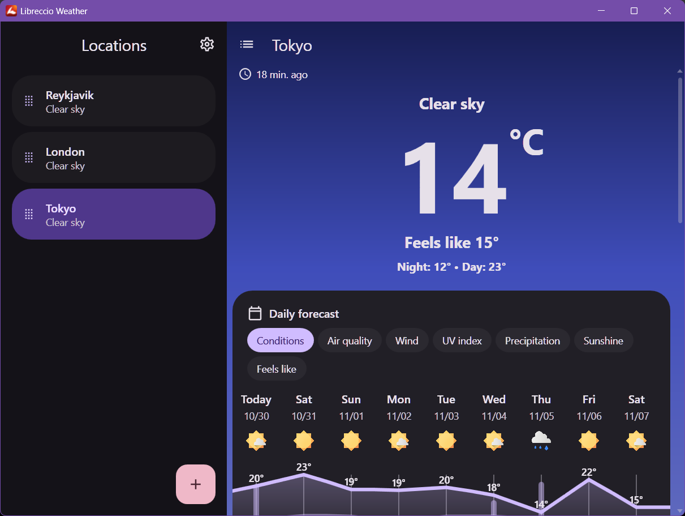
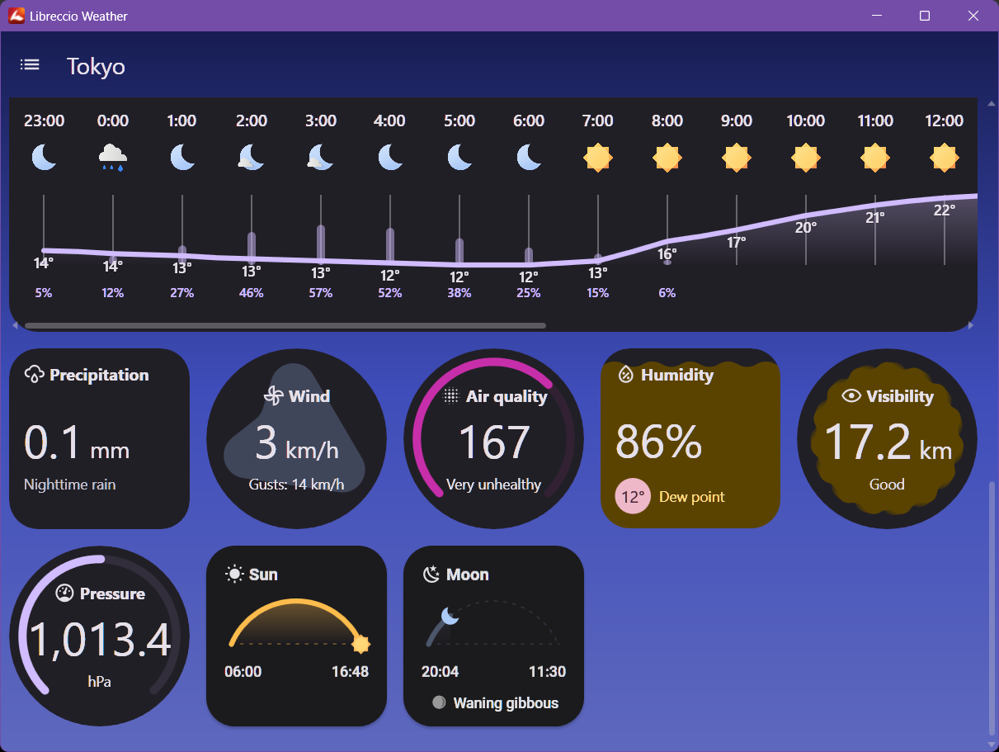
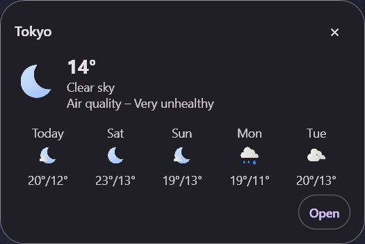

<div align="center">


# Libreccio Weather

[](#download)
[](https://learn.microsoft.com/dotnet/csharp/)
[](https://dotnet.microsoft.com/)
[](https://learn.microsoft.com/dotnet/desktop/wpf/)
[](LICENCE.md)
[](https://github.com/Nouni2/Libreccio-Weather/releases/tag/v0.1.0-alpha1)

#### Libreccio Weather is an unofficial Windows port of [Breezy Weather](https://github.com/breezy-weather/breezy-weather), free and open source.

</div>

## Download

Download `0.1.0-alpha1` from its [GitHub release](https://github.com/Nouni2/Libreccio-Weather/releases/tag/v0.1.0-alpha1).

Libreccio Weather is developed and tested on Windows 11. Solar calculations require an x64 process.

## Screenshots

<p align="center">
  
  
</p>
<p align="center">
  
</p>

## Features

- Current weather and daily and hourly forecasts from Open-Meteo. Air quality and pollen depend on coverage; pollen covers Europe.
- Location search, saved locations, reordering and Undo after deletion.
- Forecast charts and daily detail pages for temperature, feels-like temperature, precipitation, wind, air quality and UV.
- Cards for current conditions, including humidity and dew point, visibility, pressure and pollen.
- Sunrise, sunset, twilight and day length from [Seasonal++](https://github.com/Nouni2/Seasonal-plus-plus); moonrise, moonset, phases and altitude charts.
- Mistray condition and temperature icons, with an optional second icon. Four popup styles: compact, multiple locations, daily and hourly.
- Background updates with a refresh interval and Battery saver setting, plus saved forecasts for offline use.
- English and French, localized dates and numbers, and a choice of measurement units.
- A dark Material 3 interface with per-monitor scaling and animations at the monitor's refresh rate.
- An experimental desktop mode with compact controls, keyboard shortcuts and location context menus.

## Origin

I wanted a good weather app on Windows. I tried plenty of them, and none were good enough for my liking. Breezy Weather was one I really liked on Android, so so I decided to port it.

## App icons

The main window uses the selected location's meteorological season for its icon, reversing seasons south of the equator. The executable keeps the non-seasonal logo.

| Non-seasonal | Spring | Summer | Autumn | Winter |
|:---:|:---:|:---:|:---:|:---:|
|  |  |  |  |  |

## Alpha scope

In `0.1.0-alpha1`, you get Open-Meteo forecasts and a dark interface. I haven't ported automatic location detection, provider selection, light themes, Windows weather notifications or autostart. See the [roadmap](ROADMAP.md) for the remaining features.

The bundled solar DLL requires x64; you cannot use it in an ARM64 process.

## Data and privacy

You send search terms and location coordinates to [Open-Meteo](https://open-meteo.com/) when you search for a place or request weather. Read [Open-Meteo's privacy policy](https://open-meteo.com/en/terms#privacy).

Find your saved locations, weather cache and settings in `%LOCALAPPDATA%\Libreccio Weather\`. You need an internet connection to download new forecasts.

## Building from source

Install the [.NET 10 SDK](https://dotnet.microsoft.com/download/dotnet/10.0) on Windows, using the version in [global.json](global.json).

Clone the repository:

```powershell
git clone https://github.com/Nouni2/Libreccio-Weather.git
```

Build the solution:

```powershell
dotnet build Libreccio-Weather.slnx --configuration Release
```

Run the tests:

```powershell
dotnet test --solution Libreccio-Weather.slnx --configuration Release
```

Run the application:

```powershell
dotnet run --project Libreccio-Weather.csproj --configuration Release --no-build
```

Find build output in `build/`, including copies of `native/spp.dll` for the app and tests. Run solar integration tests in an x64 process.

## Contribute

Report bugs or request features in [GitHub Issues](https://github.com/Nouni2/Libreccio-Weather/issues). Include the app and Windows versions, steps to reproduce the bug and a screenshot if it helps.

Before contributing, read [CONTRIBUTING.md](CONTRIBUTING.md) and [AGENTS.md](AGENTS.md). Use the [port map](docs/port-map.md) to find the upstream source and documented platform differences.


## Credits

Libreccio Weather reuses the library from my own [Seasonal++](https://github.com/Nouni2/Seasonal-plus-plus) project for its solar calculations.

- The [Breezy Weather](https://github.com/breezy-weather/breezy-weather) community, for the Android app and its translations (LGPL-3.0-only).
- [Open-Meteo](https://open-meteo.com/) and its data providers for weather and location search.
- [commons-suncalc](https://github.com/shred/commons-suncalc) for lunar calculations.

See [third-party notices](docs/third-party-notices.md) for artwork, font and calculation-library licences.

## Licence

See the [GNU General Public License v3.0](LICENCE.md) for Libreccio Weather's licence and [third-party notices](docs/third-party-notices.md) for bundled components.
